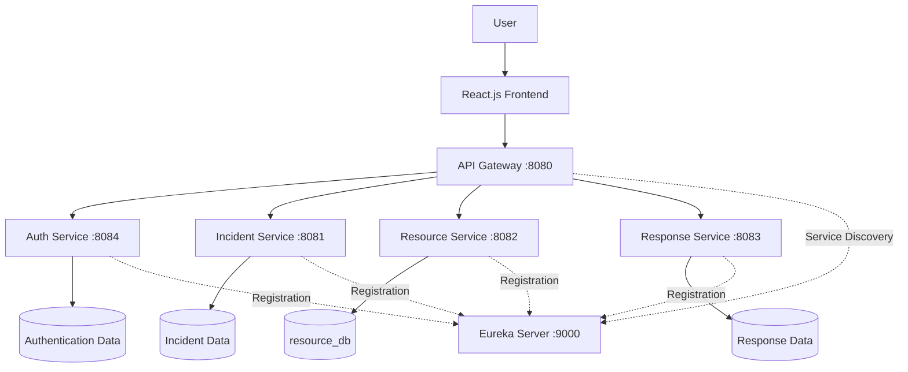
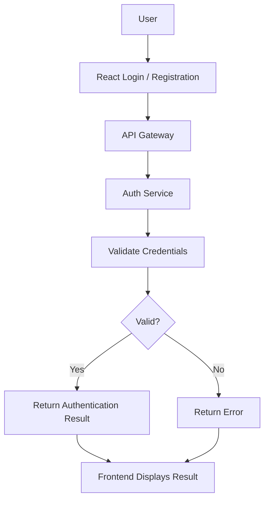
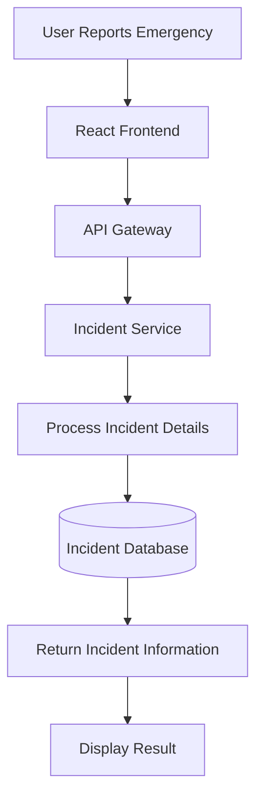
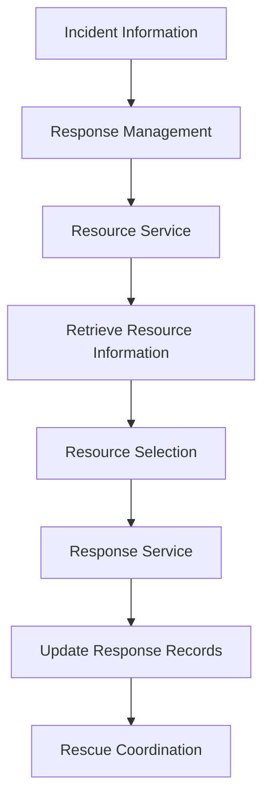

# 🚨 Emergency Rescue – Full Stack Emergency Response System

A microservices-based emergency response management platform designed to streamline incident reporting, resource management, and rescue coordination through independent backend services and RESTful APIs.

## 📌 Project Overview

Emergency Rescue is a full-stack application that provides a centralized platform for managing emergency incidents and coordinating rescue operations.

The system follows a **Microservices Architecture**, where individual services handle authentication, incident management, resource management, and response coordination independently.

The application uses Spring Boot for backend development, React.js for the frontend, PostgreSQL for data persistence, and Spring Cloud Netflix Eureka for service discovery.

### 🎯 Objectives

- Simplify emergency incident reporting and management.
- Enable efficient allocation and management of emergency resources.
- Coordinate rescue operations through independent microservices.
- Provide secure authentication and centralized API access.
- Improve maintainability and scalability through service separation.

---

## 🛠️ Technology Stack

| Category | Technologies |
|---|---|
| Programming Language | Java |
| Backend Framework | Spring Boot |
| Microservices | Spring Cloud |
| Service Discovery | Netflix Eureka |
| API Gateway | Spring Cloud Gateway |
| Frontend | React.js, HTML, CSS, JavaScript |
| Database | PostgreSQL |
| API Communication | REST APIs, HTTP |
| API Testing | Postman / REST Client |
| Build Tool | Maven |
| Version Control | Git, GitHub |
| Development Environment | IntelliJ IDEA / Spring Tool Suite |

---

## 🏗️ System Architecture

The application follows a microservices architecture in which each service is responsible for a specific business functionality.

### Architecture Diagram



*Note: Database labels represent logical data responsibilities. Configure the actual database names and service connections according to your project.*

### Architecture Components

**1. Frontend – React.js**
- Provides the user interface for interacting with the system.
- Communicates with backend services through REST APIs.
- Displays incident information and rescue-related data.

**2. API Gateway – Port 8080**
- Acts as the single entry point for client requests.
- Routes incoming requests to the appropriate microservices.
- Centralizes API access and simplifies service communication.

**3. Eureka Server – Port 9000**
- Maintains a registry of available microservices.
- Allows services to register themselves.
- Supports service discovery between distributed services.

**4. Backend Microservices**
- Each service handles a specific business responsibility.
- Services operate independently.
- REST APIs enable communication between application components.

---

## ⚙️ Microservices and Responsibilities

### 1. Auth Service
**Port:** 8084

Responsible for user authentication and account management.

Features:
- User registration.
- User login and authentication.
- Credential validation.
- Authentication-related API endpoints.

### 2. Incident Service
**Port:** 8081

Responsible for managing emergency incidents.

Features:
- Incident reporting and registration.
- Incident information management.
- Tracking and retrieving reported incidents.
- Providing incident data through REST APIs.

### 3. Resource Service
**Port:** 8082

Responsible for managing emergency response resources.

Features:
- Resource registration and management.
- Retrieving available resource information.
- Updating resource records.
- Maintaining resource data using PostgreSQL.

### 4. Response Service
**Port:** 8083

Responsible for managing emergency response operations.

Features:
- Managing rescue response information.
- Coordinating incident response activities.
- Maintaining response-related records.
- Providing response management APIs.

---

## 🔄 Application Workflow

### 1. User Authentication Workflow



### 2. Emergency Incident Workflow



### 3. Resource and Rescue Coordination Workflow



*These diagrams represent the intended application workflows. Adapt the exact steps to match the implemented frontend and backend functionality.*

---

## 🔗 API Gateway and Routing

The API Gateway handles incoming requests and forwards them to the appropriate backend service.

| Service | Gateway Route | Service Port |
|---|---|---|
| Auth Service | `/auth/**` | 8084 |
| Incident Service | `/incidents/**` | 8081 |
| Resource Service | `/resources/**` | 8082 |
| Response Service | Configure implemented route | 8083 |

Example API requests:

```http
POST http://localhost:8080/auth/register

POST http://localhost:8080/auth/login

GET http://localhost:8080/incidents/

GET http://localhost:8080/resources/
```

*Adjust HTTP methods and endpoint paths according to your actual controller mappings.*

---

## 🗄️ Database Management

**Database Technology: PostgreSQL**

PostgreSQL is used for persistent storage of application data.

Database responsibilities include:

- User and authentication information.
- Emergency incident records.
- Resource information.
- Rescue response records.

The Resource Service uses the `resource_db` database.

Spring Data JPA and Hibernate can be used for database interaction and entity management wherever configured in the services.

---

## 🔍 Key Technical Concepts Implemented

| Concept | Application |
|---|---|
| Microservices Architecture | Separating application functionality into independent services |
| RESTful APIs | Communication between frontend and backend |
| Service Discovery | Registering and discovering services using Eureka |
| API Gateway | Centralized request routing |
| Database Integration | Persistent storage using PostgreSQL |
| Spring Boot | Backend service development |
| React.js | Frontend application development |
| Maven | Dependency and build management |
| API Testing | Testing endpoints using Postman / REST Client |

---

## 🚀 Getting Started

### Prerequisites

Install the following:

- Java JDK
- Maven
- Node.js and npm
- PostgreSQL
- Git
- Postman (optional)

### 1. Clone the Repository

```bash
git clone YOUR_GITHUB_REPOSITORY_URL

cd Emergency-Rescue
```

### 2. Configure PostgreSQL

- Start your PostgreSQL server.
- Create the required databases.
- Update database credentials in each service's application configuration.
- Verify database connectivity.

### 3. Start Eureka Server

Run the Eureka Server application on port `9000`.

Access the dashboard:

```text
http://localhost:9000
```

### 4. Start Backend Microservices

Start the services in the following order:

1. Auth Service – `8084`
2. Incident Service – `8081`
3. Resource Service – `8082`
4. Response Service – `8083`

Verify that the services are registered with Eureka.

### 5. Start API Gateway

Run the API Gateway on port `8080`.

The gateway will route requests to the configured backend services.

### 6. Start React Frontend

Navigate to the frontend directory:

```bash
cd frontend

npm install

npm run dev
```

Open the local development URL displayed in the terminal.

---

## 🧪 Testing

The backend REST APIs can be tested using Postman or the VS Code REST Client extension.

Testing includes:

- User registration and login.
- Incident creation and retrieval.
- Resource management operations.
- Response management operations.
- API Gateway routing.
- Eureka service registration.
- PostgreSQL database connectivity.

---

## 📈 Future Enhancements

- Real-time emergency notifications.
- GPS-based incident location tracking.
- Live rescue team tracking.
- Role-based access control.
- Automated emergency resource allocation.
- Real-time communication using WebSockets.
- Cloud deployment and containerization using Docker.

---

## 👩‍💻 Project Information

**Project Name:** Emergency Rescue – Full Stack Emergency Response System

**Architecture:** Microservices

**Backend:** Java, Spring Boot, Spring Cloud

**Frontend:** React.js

**Database:** PostgreSQL

**Version Control:** Git and GitHub

**Project Type:** Full Stack Development | Microservices | REST API Development

---

⭐ If you find this project useful, consider giving the repository a star!
